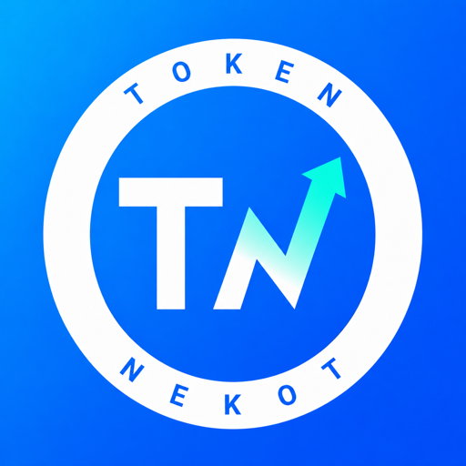

# Jeman brand assets

Logos, app icons and screenshots for writing about Jeman and its apps.

## About Jeman

- **Jeman** is a small independent studio making simple, thoughtful apps for Mac and iPhone.
- **Tagline:** Keep it simple. Take it slow. (always written in English)
- **Website:** [jeman.net](https://jeman.net)
- **Contact:** [support@jeman.net](mailto:support@jeman.net)

## Apps

| | App | Platform | One line |
|---|---|---|---|
|  | [Netlink](https://jeman.net/netlink/) | macOS 14 or later · [Mac App Store](https://apps.apple.com/app/id6770569501) | Know when your exit IP changes. Network score, VPN and DNS checks, right in your menu bar. |
|  | [Nekot](https://jeman.net/nekot/) | iOS 17 or later · [App Store](https://apps.apple.com/app/id6805865049) | Claude Code and Codex usage windows, reset countdowns and limit alerts on your iPhone. |

Both apps are free to download, with Pro unlocked by an in-app purchase. Prices vary by region and are shown on the App Store.

## Logo

| File | Use it on |
|---|---|
| [`logo/jeman-logo.png`](logo/jeman-logo.png) | Any background (transparent, 512 × 512) |
| [`logo/jeman-logo-on-light.png`](logo/jeman-logo-on-light.png) | Light layouts, avatars (1024 × 1024) |
| [`logo/jeman-logo-on-dark.png`](logo/jeman-logo-on-dark.png) | Dark layouts (1024 × 1024) |

Please keep some clear space around the logo, and don't recolor, stretch, rotate or add effects to it. Write the name as **Jeman**, with a capital J.

## Colors

| Name | Hex |
|---|---|
| Jeman teal | `#55DDCD` |
| Ink | `#141414` |
| Paper | `#FAFAF7` |
| Netlink deep teal / green | `#0E3A47` / `#5BE37D` |
| Nekot blue / aqua | `#0B5CFF` / `#2BF0D8` |

## App icons

[`app-icons/`](app-icons/) has the Netlink and Nekot icons at 512 × 512. Please use them as they are, without cropping, recoloring or adding borders.

## Screenshots

[`screenshots/`](screenshots/) has real app screenshots. IP addresses shown in them are reserved documentation examples, not real addresses.

For App Store badges, use Apple's official artwork and follow [Apple's marketing guidelines](https://developer.apple.com/app-store/marketing/guidelines/) rather than recreating them.

## Using these assets

You're welcome to use these files to write about, review or link to Jeman and its apps. Please don't use them in a way that suggests we endorse you, or for other products.

These files are not covered by any open license. All rights reserved. Questions? Email [support@jeman.net](mailto:support@jeman.net).
